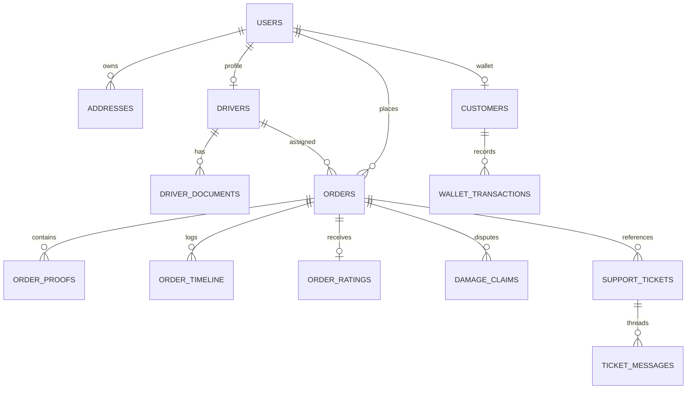

# Implementation Plan: Local Move Complete Backend System

## 1. Recommended Backend Stack & Architecture

### Stack Selection
- **Runtime**: Node.js (v24.x LTS)
- **Language**: TypeScript (strict mode, high fidelity typing shared/aligned with `src/types/index.ts`)
- **HTTP Framework**: Express.js
- **Database**: SQLite with `@libsql/client` / `better-sqlite3` (file-based relational SQL database stored in `server/data/localmove.db`)
- **Validation**: `Zod` (schema-based request payload, params, and query validation with detailed error formatting)
- **Security & Middleware**: `cors`, `helmet`, `express-rate-limit`, `cookie-parser`, `dotenv`
- **File & Media Handling**: Local static disk storage (`server/uploads/`) with multipart upload endpoint (`POST /api/v1/uploads`) for proof photos and KYC documents
- **Process & Dev Orchestration**: `tsx` (fast TypeScript execution engine with hot-reload in development)

### Justification
1. **Zero External Infrastructure Friction**: SQLite requires no external daemon, Docker container, or cloud service to be installed on the user's Windows machine. It runs instantly, enforces real foreign keys, indexed queries, and ACID transactions.
2. **Type Continuity**: The frontend is written in TypeScript using rich interfaces (`Order`, `DriverProfile`, `FareBreakdown`, `PricingConfig`, `DamageClaim`, `SupportTicket`). Writing the backend in TypeScript enables zero-impedance impedance matching of contract shapes.
3. **Modularity & Scalability**: Clean layered architecture separating `routes`, `controllers`, `services`, `repositories/models`, `middlewares`, and `validations`.
4. **Minimal Frontend Disruption**: The frontend React app will be connected via a lightweight API client service in `src/services/api.ts` that interacts with `/api/v1`, preserving existing React Context hooks (`useOrders`, `useAuth`) and UI components without redesign.

---

## 2. Database Schema Design

The SQLite database (`server/data/localmove.db`) uses strict foreign keys (`PRAGMA foreign_keys = ON;`) and WAL mode for high concurrency.



### Table Definitions

#### `users`
| Column | Type | Constraints | Description |
|---|---|---|---|
| `id` | VARCHAR(64) | PRIMARY KEY | User identifier (e.g. `cust-demo`, `drv-1`, `adm-1`) |
| `role` | VARCHAR(20) | NOT NULL CHECK (role IN ('customer', 'driver', 'admin', 'receiver')) | System role |
| `admin_sub_role` | VARCHAR(20) | NULL CHECK (admin_sub_role IN ('super_admin', 'operations', 'support', 'finance')) | Subrole for admin users |
| `name` | VARCHAR(120) | NOT NULL | User's full name |
| `phone` | VARCHAR(20) | NOT NULL UNIQUE | 10-digit mobile number |
| `email` | VARCHAR(120) | NOT NULL | Email address |
| `language` | VARCHAR(5) | NOT NULL DEFAULT 'en' | Preferred language ('en', 'hi', 'gu') |
| `created_at` | DATETIME | NOT NULL DEFAULT CURRENT_TIMESTAMP | Created timestamp |
| `updated_at` | DATETIME | NOT NULL DEFAULT CURRENT_TIMESTAMP | Last updated timestamp |

#### `customers`
| Column | Type | Constraints | Description |
|---|---|---|---|
| `user_id` | VARCHAR(64) | PRIMARY KEY REFERENCES users(id) ON DELETE CASCADE | Customer user ID |
| `wallet_balance` | DECIMAL(10,2) | NOT NULL DEFAULT 350.00 | Current wallet balance in INR |
| `created_at` | DATETIME | NOT NULL DEFAULT CURRENT_TIMESTAMP | Timestamp |
| `updated_at` | DATETIME | NOT NULL DEFAULT CURRENT_TIMESTAMP | Timestamp |

#### `drivers`
| Column | Type | Constraints | Description |
|---|---|---|---|
| `id` | VARCHAR(64) | PRIMARY KEY REFERENCES users(id) ON DELETE CASCADE | Driver ID |
| `vehicle_type` | VARCHAR(30) | NOT NULL | 'bike', 'cargo_auto', 'mini_truck', 'large_tempo', 'truck_eicher' |
| `vehicle_number` | VARCHAR(30) | NOT NULL | Registration plate (e.g. GJ-01-BK-8924) |
| `vehicle_model` | VARCHAR(60) | NOT NULL | Vehicle model description |
| `avatar` | TEXT | NOT NULL | URL to driver avatar |
| `is_online` | BOOLEAN | NOT NULL DEFAULT 1 | Whether driver is active on radar |
| `status` | VARCHAR(20) | NOT NULL DEFAULT 'approved' CHECK (status IN ('pending', 'approved', 'rejected', 'suspended')) | KYC & operational status |
| `rating` | DECIMAL(3,2) | NOT NULL DEFAULT 4.85 | Star rating (1.00 - 5.00) |
| `total_trips` | INTEGER | NOT NULL DEFAULT 0 | Completed deliveries count |
| `acceptance_rate` | INTEGER | NOT NULL DEFAULT 95 | Acceptance percentage |
| `completion_rate` | INTEGER | NOT NULL DEFAULT 98 | Completion percentage |
| `cash_in_hand_balance`| DECIMAL(10,2) | NOT NULL DEFAULT 0.00 | Total physical cash currently held |
| `company_share_owed` | DECIMAL(10,2) | NOT NULL DEFAULT 0.00 | Commission owed to platform |
| `today_earnings` | DECIMAL(10,2) | NOT NULL DEFAULT 0.00 | Net earnings accrued today |
| `active_delivery_minutes` | INTEGER | NOT NULL DEFAULT 0 | Active in-transit minutes |
| `online_minutes` | INTEGER | NOT NULL DEFAULT 0 | Total online duty minutes |
| `waiting_minutes` | INTEGER | NOT NULL DEFAULT 0 | Waiting minutes at doorstep |
| `current_lat` | DECIMAL(10,6) | NOT NULL DEFAULT 23.0225 | Current GPS latitude |
| `current_lng` | DECIMAL(10,6) | NOT NULL DEFAULT 72.5714 | Current GPS longitude |
| `active_order_id` | VARCHAR(64) | NULL | Currently active order ID |
| `created_at` | DATETIME | NOT NULL DEFAULT CURRENT_TIMESTAMP | Timestamp |
| `updated_at` | DATETIME | NOT NULL DEFAULT CURRENT_TIMESTAMP | Timestamp |

#### `driver_documents`
| Column | Type | Constraints | Description |
|---|---|---|---|
| `id` | VARCHAR(64) | PRIMARY KEY | Document UUID |
| `driver_id` | VARCHAR(64) | NOT NULL REFERENCES drivers(id) ON DELETE CASCADE | Associated driver |
| `doc_type` | VARCHAR(20) | NOT NULL CHECK (doc_type IN ('licence', 'aadhaar', 'rc', 'selfie')) | Type of document |
| `status` | VARCHAR(20) | NOT NULL DEFAULT 'approved' CHECK (status IN ('pending', 'approved', 'rejected', 'expired')) | Document verification state |
| `number` | VARCHAR(60) | NULL | Legal document identifier number |
| `masked_number` | VARCHAR(60) | NULL | Privacy-masked representation (e.g. XXXX-XXXX-4129) |
| `expiry_date` | VARCHAR(30) | NULL | Expiry date string |
| `front_url` | TEXT | NULL | Image URL for front view |
| `back_url` | TEXT | NULL | Image URL for back view |
| `rejection_reason` | TEXT | NULL | Reason text if rejected |

#### `addresses`
| Column | Type | Constraints | Description |
|---|---|---|---|
| `id` | VARCHAR(64) | PRIMARY KEY | Address ID (e.g. `addr-1`) |
| `user_id` | VARCHAR(64) | NOT NULL REFERENCES users(id) ON DELETE CASCADE | Associated customer |
| `title` | VARCHAR(60) | NOT NULL | Friendly title (Home, Office, Shop) |
| `full_address` | TEXT | NOT NULL | Complete formatted street address |
| `landmark` | VARCHAR(120) | NULL | Optional nearby landmark |
| `floor` | VARCHAR(60) | NULL | Floor / gate instructions |
| `instructions` | TEXT | NULL | Special arrival instructions |
| `city` | VARCHAR(60) | NOT NULL DEFAULT 'Ahmedabad' | City name |
| `lat` | DECIMAL(10,6) | NOT NULL | Latitude |
| `lng` | DECIMAL(10,6) | NOT NULL | Longitude |
| `created_at` | DATETIME | NOT NULL DEFAULT CURRENT_TIMESTAMP | Timestamp |

#### `orders`
| Column | Type | Constraints | Description |
|---|---|---|---|
| `id` | VARCHAR(64) | PRIMARY KEY | Order identifier (e.g. `LM-6301`) |
| `tracking_token` | VARCHAR(64) | NOT NULL UNIQUE | Unique public tracking token |
| `status` | VARCHAR(30) | NOT NULL | `created`, `searching_driver`, `driver_assigned`, `arrived_at_pickup`, `picked_up`, `in_transit`, `arrived_at_drop`, `delivered`, `completed`, `cancelled`, `failed_returned`, `under_dispute` |
| `customer_id` | VARCHAR(64) | NOT NULL REFERENCES users(id) | Ordering customer ID |
| `assigned_driver_id` | VARCHAR(64) | NULL REFERENCES drivers(id) | Assigned delivery partner |
| `sender_name` | VARCHAR(120) | NOT NULL | Sender name |
| `sender_phone` | VARCHAR(20) | NOT NULL | Sender phone |
| `receiver_name` | VARCHAR(120) | NOT NULL | Recipient name |
| `receiver_phone` | VARCHAR(20) | NOT NULL | Recipient phone |
| `pickup_address_json` | TEXT | NOT NULL | Serialized JSON `Address` object |
| `drop_address_json` | TEXT | NOT NULL | Serialized JSON `Address` object |
| `item_json` | TEXT | NOT NULL | Serialized JSON `OrderItem` object |
| `vehicle_type` | VARCHAR(30) | NOT NULL | Assigned vehicle category |
| `helpers_count` | INTEGER | NOT NULL DEFAULT 0 | Loading helpers count |
| `has_packing_service` | BOOLEAN | NOT NULL DEFAULT 0 | Whether packing service is booked |
| `has_item_protection` | BOOLEAN | NOT NULL DEFAULT 0 | Whether transit insurance is active |
| `is_scheduled` | BOOLEAN | NOT NULL DEFAULT 0 | Whether trip is scheduled |
| `scheduled_time` | VARCHAR(60) | NULL | Scheduled date & time slot |
| `return_to_sender_if_failed` | BOOLEAN | NOT NULL DEFAULT 1 | Return item to sender on delivery failure |
| `fare_json` | TEXT | NOT NULL | Serialized JSON `FareBreakdown` object |
| `payment_method` | VARCHAR(20) | NOT NULL | `cash`, `upi`, `card`, `wallet`, `receiver_pays` |
| `payment_status` | VARCHAR(20) | NOT NULL | `pending`, `success`, `failed`, `refunded` |
| `payer` | VARCHAR(20) | NOT NULL | `sender`, `receiver` |
| `pickup_otp` | CHAR(4) | NOT NULL | 4-digit pickup handover OTP |
| `drop_otp` | CHAR(4) | NOT NULL | 4-digit drop handover OTP |
| `pickup_otp_verified` | BOOLEAN | NOT NULL DEFAULT 0 | Whether pickup OTP has been entered |
| `pickup_otp_entered_at` | DATETIME | NULL | Timestamp when pickup OTP verified |
| `pickup_sender_confirmed` | BOOLEAN | NOT NULL DEFAULT 0 | Whether driver confirmed sender name |
| `pickup_customer_approved`| BOOLEAN | NOT NULL DEFAULT 0 | Whether sender approved packing |
| `drop_otp_verified` | BOOLEAN | NOT NULL DEFAULT 0 | Whether drop OTP has been entered |
| `drop_otp_entered_at` | DATETIME | NULL | Timestamp when drop OTP verified |
| `drop_receiver_confirmed` | BOOLEAN | NOT NULL DEFAULT 0 | Whether driver confirmed receiver name |
| `drop_receiver_acknowledged`| BOOLEAN | NOT NULL DEFAULT 0 | Receiver acknowledged package condition |
| `drop_issue_reported` | TEXT | NULL | Issue note reported at drop |
| `cash_collected_confirmed`| BOOLEAN | NOT NULL DEFAULT 0 | Driver recorded cash receipt |
| `cash_amount_collected` | DECIMAL(10,2) | NULL | Recorded cash collected amount |
| `cancel_reason` | TEXT | NULL | Reason if cancelled |
| `is_delayed` | BOOLEAN | NOT NULL DEFAULT 0 | Delay indicator |
| `last_known_lat` | DECIMAL(10,6) | NULL | Real-time driver latitude |
| `last_known_lng` | DECIMAL(10,6) | NULL | Real-time driver longitude |
| `reschedule_requested_by` | VARCHAR(20) | NULL | 'receiver' or 'customer' |
| `reschedule_new_date` | VARCHAR(30) | NULL | Rescheduled date |
| `reschedule_new_timeslot` | VARCHAR(60) | NULL | Rescheduled slot |
| `reschedule_status` | VARCHAR(20) | NULL | 'pending', 'approved', 'rejected' |
| `created_at` | DATETIME | NOT NULL DEFAULT CURRENT_TIMESTAMP | Timestamp |
| `updated_at` | DATETIME | NOT NULL DEFAULT CURRENT_TIMESTAMP | Timestamp |

#### `order_proofs`
| Column | Type | Constraints | Description |
|---|---|---|---|
| `id` | VARCHAR(64) | PRIMARY KEY | Proof UUID |
| `order_id` | VARCHAR(64) | NOT NULL REFERENCES orders(id) ON DELETE CASCADE | Associated order |
| `stage` | VARCHAR(10) | NOT NULL CHECK (stage IN ('pickup', 'drop')) | Pickup or drop proof |
| `type` | VARCHAR(10) | NOT NULL CHECK (type IN ('photo', 'video')) | Media type |
| `url` | TEXT | NOT NULL | Media URL |
| `notes` | TEXT | NULL | Driver notes |
| `timestamp` | DATETIME | NOT NULL DEFAULT CURRENT_TIMESTAMP | Timestamp |

#### `order_timeline`
| Column | Type | Constraints | Description |
|---|---|---|---|
| `id` | INTEGER | PRIMARY KEY AUTOINCREMENT | Timeline event ID |
| `order_id` | VARCHAR(64) | NOT NULL REFERENCES orders(id) ON DELETE CASCADE | Associated order |
| `status` | VARCHAR(30) | NOT NULL | Status event |
| `note` | TEXT | NOT NULL | Human-readable audit note |
| `timestamp` | DATETIME | NOT NULL DEFAULT CURRENT_TIMESTAMP | Timestamp |

#### `order_ratings`
| Column | Type | Constraints | Description |
|---|---|---|---|
| `id` | VARCHAR(64) | PRIMARY KEY | Rating UUID |
| `order_id` | VARCHAR(64) | NOT NULL UNIQUE REFERENCES orders(id) ON DELETE CASCADE | Associated order |
| `stars` | INTEGER | NOT NULL CHECK (stars BETWEEN 1 AND 5) | Rating score |
| `comment` | TEXT | NULL | Customer review comment |
| `tip_inr` | DECIMAL(10,2) | NOT NULL DEFAULT 0.00 | Tip credited to driver |
| `created_at` | DATETIME | NOT NULL DEFAULT CURRENT_TIMESTAMP | Timestamp |

#### `wallet_transactions`
| Column | Type | Constraints | Description |
|---|---|---|---|
| `id` | VARCHAR(64) | PRIMARY KEY | Transaction UUID (e.g. `tx-1`) |
| `customer_id` | VARCHAR(64) | NOT NULL REFERENCES customers(user_id) | Customer wallet |
| `order_id` | VARCHAR(64) | NULL REFERENCES orders(id) | Associated order if any |
| `title` | VARCHAR(160) | NOT NULL | Description (e.g. Recharge, Order Payment) |
| `amount` | DECIMAL(10,2) | NOT NULL | Transaction amount (positive for credit, negative for debit) |
| `type` | VARCHAR(10) | NOT NULL CHECK (type IN ('credit', 'debit')) | Credit or debit |
| `timestamp` | DATETIME | NOT NULL DEFAULT CURRENT_TIMESTAMP | Timestamp |

#### `damage_claims`
| Column | Type | Constraints | Description |
|---|---|---|---|
| `id` | VARCHAR(64) | PRIMARY KEY | Claim ID (e.g. `CLM-101`) |
| `order_id` | VARCHAR(64) | NOT NULL REFERENCES orders(id) | Disputed order |
| `customer_id` | VARCHAR(64) | NOT NULL REFERENCES users(id) | Filing customer |
| `customer_name` | VARCHAR(120) | NOT NULL | Customer name |
| `customer_phone` | VARCHAR(20) | NOT NULL | Customer phone |
| `driver_name` | VARCHAR(120) | NOT NULL | Driver on trip |
| `item_description` | VARCHAR(255) | NOT NULL | Item name/type |
| `declared_value_inr` | DECIMAL(10,2) | NOT NULL | Declared value |
| `claimed_amount_inr` | DECIMAL(10,2) | NOT NULL | Customer's claim amount |
| `approved_compensation_inr` | DECIMAL(10,2) | NULL | Approved payout |
| `pickup_photos_json` | TEXT | NOT NULL | JSON array of photo URLs |
| `drop_photos_json` | TEXT | NOT NULL | JSON array of photo URLs |
| `description` | TEXT | NOT NULL | Customer statement |
| `status` | VARCHAR(20) | NOT NULL DEFAULT 'under_review' CHECK (status IN ('open', 'under_review', 'approved', 'rejected')) | Claim state |
| `assigned_investigator`| VARCHAR(120) | NULL | Operations agent assigned |
| `resolution_notes` | TEXT | NULL | Investigator resolution rationale |
| `created_at` | DATETIME | NOT NULL DEFAULT CURRENT_TIMESTAMP | Timestamp |
| `updated_at` | DATETIME | NOT NULL DEFAULT CURRENT_TIMESTAMP | Timestamp |

#### `support_tickets`
| Column | Type | Constraints | Description |
|---|---|---|---|
| `id` | VARCHAR(64) | PRIMARY KEY | Ticket ID (e.g. `TCK-201`) |
| `order_id` | VARCHAR(64) | NULL REFERENCES orders(id) | Associated order |
| `user_id` | VARCHAR(64) | NOT NULL REFERENCES users(id) | Ticket creator |
| `user_role` | VARCHAR(20) | NOT NULL | 'customer', 'driver', 'receiver' |
| `user_name` | VARCHAR(120) | NOT NULL | User's name |
| `user_phone` | VARCHAR(20) | NOT NULL | User's phone |
| `subject` | VARCHAR(255) | NOT NULL | Ticket title |
| `category` | VARCHAR(30) | NOT NULL | 'delivery_delay', 'damage_claim', 'wrong_charge', 'driver_issue', 'receiver_absent', 'other' |
| `status` | VARCHAR(20) | NOT NULL DEFAULT 'open' CHECK (status IN ('open', 'in_progress', 'resolved', 'closed')) | Ticket state |
| `priority` | VARCHAR(10) | NOT NULL DEFAULT 'medium' CHECK (priority IN ('low', 'medium', 'high', 'urgent')) | Ticket priority |
| `created_at` | DATETIME | NOT NULL DEFAULT CURRENT_TIMESTAMP | Timestamp |
| `updated_at` | DATETIME | NOT NULL DEFAULT CURRENT_TIMESTAMP | Timestamp |

#### `ticket_messages`
| Column | Type | Constraints | Description |
|---|---|---|---|
| `id` | VARCHAR(64) | PRIMARY KEY | Message UUID |
| `ticket_id` | VARCHAR(64) | NOT NULL REFERENCES support_tickets(id) ON DELETE CASCADE | Associated ticket |
| `sender` | VARCHAR(10) | NOT NULL CHECK (sender IN ('user', 'agent')) | Sender party |
| `sender_name` | VARCHAR(120) | NOT NULL | Sender display name |
| `text` | TEXT | NOT NULL | Message body |
| `timestamp` | DATETIME | NOT NULL DEFAULT CURRENT_TIMESTAMP | Timestamp |

#### `pricing_config`
| Column | Type | Constraints | Description |
|---|---|---|---|
| `id` | VARCHAR(64) | PRIMARY KEY | Config ID (e.g. `cfg-ahmedabad`) |
| `city` | VARCHAR(60) | NOT NULL UNIQUE | Service city |
| `config_json` | TEXT | NOT NULL | Serialized JSON `PricingConfig` |
| `is_active` | BOOLEAN | NOT NULL DEFAULT 1 | Active flag |
| `updated_at` | DATETIME | NOT NULL DEFAULT CURRENT_TIMESTAMP | Timestamp |

#### `prohibited_items` & `faqs`
- `prohibited_items`: id, name, category, fine_amount, risk_level ('critical', 'high', 'medium'), is_active
- `faqs`: id, category ('customer', 'driver', 'safety'), question, answer, is_active

#### `notifications`
- `notifications`: id, user_id (NULL = broadcast), title, description, category, is_read, order_id, action_url, action_label, timestamp

#### `audit_logs`
- `audit_logs`: id, action, operator, role, target, details, timestamp, ip

---

## 3. Complete API Contract (`/api/v1`)

All endpoints return a standardized JSON structure:
- **Success**: `{ "success": true, "data": ... }`
- **Error**: `{ "success": false, "error": { "code": string, "message": string, "details"?: any } }`

### 3.1 Authentication & Sessions
| Method | Path | Purpose | Request Body | Response Shape | Success Code | Error Codes |
|---|---|---|---|---|---|---|
| `POST` | `/api/v1/auth/customer/login` | Authenticate customer by mobile & OTP | `{ phone: string, name?: string, otp?: string }` | `{ success: true, data: { user: CustomerUser, token: string } }` | `200` | `400, 401` |
| `POST` | `/api/v1/auth/driver/login` | Authenticate driver by mobile & OTP | `{ phone: string, otp?: string }` | `{ success: true, data: { driver: DriverProfile, token: string } }` | `200` | `400, 401` |
| `GET` | `/api/v1/auth/me` | Fetch active authenticated profile | None (Bearer token or cookie) | `{ success: true, data: { user: User, profile?: any } }` | `200` | `401` |
| `POST` | `/api/v1/auth/logout` | Terminate session | None | `{ success: true, data: { message: "Logged out" } }` | `200` | `200` |

### 3.2 Orders & Handover Protocols
| Method | Path | Purpose | Request Body | Response Shape | Success Code | Error Codes |
|---|---|---|---|---|---|---|
| `POST` | `/api/v1/orders` | Create booking | Full `Order` or `BookingFormData` payload | `{ success: true, data: { orderId: string, order: Order } }` | `201` | `400, 422` |
| `GET` | `/api/v1/orders` | List orders | Query: `?status=...&role=...&limit=...` | `{ success: true, data: { orders: Order[], total: number } }` | `200` | `400` |
| `GET` | `/api/v1/orders/:id` | Fetch order details | None | `{ success: true, data: { order: Order } }` | `200` | `404` |
| `GET` | `/api/v1/orders/track/:token` | Public receiver tracking | None | `{ success: true, data: { order: OrderSummary } }` | `200` | `404` |
| `POST` | `/api/v1/orders/track/:token/verify` | Verify receiver phone to unlock OTP | `{ phoneLast4: string }` | `{ success: true, data: { unlocked: true, dropOtp: string } }` | `200` | `400, 403` |
| `PATCH` | `/api/v1/orders/:id/status` | Update order status & append timeline | `{ status: OrderStatus, note?: string }` | `{ success: true, data: { order: Order } }` | `200` | `400, 404` |
| `POST` | `/api/v1/orders/:id/assign-driver` | Reassign driver to order | `{ driverId: string }` | `{ success: true, data: { order: Order } }` | `200` | `400, 404` |
| `POST` | `/api/v1/orders/:id/pickup/confirm-sender` | Confirm sender identity | None | `{ success: true, data: { confirmed: true } }` | `200` | `404` |
| `POST` | `/api/v1/orders/:id/pickup/verify-otp` | Validate 4-digit pickup OTP | `{ otp: string }` | `{ success: true, data: { verified: true } }` | `200` | `400, 404` |
| `POST` | `/api/v1/orders/:id/pickup/proof` | Add pickup photo/video proof | `{ type: 'photo'\|'video', url: string, notes?: string }` | `{ success: true, data: { proofId: string } }` | `201` | `400, 404` |
| `POST` | `/api/v1/orders/:id/pickup/approve` | Customer packaging sign-off | None | `{ success: true, data: { approved: true } }` | `200` | `404` |
| `POST` | `/api/v1/orders/:id/pickup/start-trip` | Validate gates & transition to `in_transit` | None | `{ success: true, data: { status: 'in_transit' } }` | `200` | `400, 404` |
| `POST` | `/api/v1/orders/:id/drop/confirm-receiver` | Confirm recipient identity | None | `{ success: true, data: { confirmed: true } }` | `200` | `404` |
| `POST` | `/api/v1/orders/:id/drop/verify-otp` | Validate 4-digit drop OTP | `{ otp: string }` | `{ success: true, data: { verified: true } }` | `200` | `400, 404` |
| `POST` | `/api/v1/orders/:id/drop/proof` | Add drop delivery proof photo | `{ type: 'photo'\|'video', url: string, notes?: string }` | `{ success: true, data: { proofId: string } }` | `201` | `400, 404` |
| `POST` | `/api/v1/orders/:id/drop/acknowledge` | Recipient condition acknowledgment | `{ issueNote?: string }` | `{ success: true, data: { acknowledged: boolean } }` | `200` | `404` |
| `POST` | `/api/v1/orders/:id/drop/collect-cash` | Confirm physical cash collection | `{ amount: number }` | `{ success: true, data: { confirmed: true, amount: number } }` | `200` | `400, 404` |
| `POST` | `/api/v1/orders/:id/drop/complete` | Complete delivery, update earnings | None | `{ success: true, data: { status: 'completed' } }` | `200` | `400, 404` |
| `POST` | `/api/v1/orders/:id/cancel` | Cancel order with audit reason | `{ reason: string }` | `{ success: true, data: { status: 'cancelled' } }` | `200` | `400, 404` |
| `POST` | `/api/v1/orders/:id/rate` | Submit partner rating & tip | `{ stars: number, comment?: string, tipInr?: number }` | `{ success: true, data: { rated: true } }` | `200` | `400, 404` |
| `POST` | `/api/v1/orders/:id/reschedule-request` | Request time slot reschedule | `{ requestedBy: 'receiver'\|'customer', newDate: string, newTimeSlot: string }` | `{ success: true, data: { rescheduled: 'pending' } }` | `200` | `400, 404` |
| `POST` | `/api/v1/orders/:id/reschedule-approve` | Confirm and apply reschedule | None | `{ success: true, data: { status: 'approved' } }` | `200` | `400, 404` |

### 3.3 Pricing & Zone Tariffs
| Method | Path | Purpose | Request Body | Response Shape | Success Code | Error Codes |
|---|---|---|---|---|---|---|
| `POST` | `/api/v1/pricing/calculate-fare` | Calculate exact fare breakdown | `FareCalculationParams` | `{ success: true, data: { fare: FareBreakdown } }` | `200` | `400` |
| `GET` | `/api/v1/pricing/config` | Get active city pricing config | Query: `?city=Ahmedabad` | `{ success: true, data: { config: PricingConfig } }` | `200` | `404` |
| `PUT` | `/api/v1/pricing/config` | Admin update city pricing parameters | `PricingConfig` | `{ success: true, data: { config: PricingConfig } }` | `200` | `400, 403` |

### 3.4 Driver Fleet & Telemetry
| Method | Path | Purpose | Request Body | Response Shape | Success Code | Error Codes |
|---|---|---|---|---|---|---|
| `GET` | `/api/v1/drivers` | List fleet with status & vehicle filters | Query: `?status=...&isOnline=...` | `{ success: true, data: { drivers: DriverProfile[] } }` | `200` | `200` |
| `GET` | `/api/v1/drivers/:id` | Driver profile & metrics | None | `{ success: true, data: { driver: DriverProfile } }` | `200` | `404` |
| `POST` | `/api/v1/drivers/onboarding` | Submit partner onboarding documents | `{ name, phone, email, vehicleType, vehicleNumber, documents }` | `{ success: true, data: { driverId: string, status: 'pending' } }` | `201` | `400` |
| `PATCH` | `/api/v1/drivers/:id/online` | Toggle duty online/offline | `{ isOnline: boolean }` | `{ success: true, data: { isOnline: boolean } }` | `200` | `404` |
| `PATCH` | `/api/v1/drivers/:id/location` | Telemetry GPS ping | `{ lat: number, lng: number }` | `{ success: true, data: { updated: true } }` | `200` | `400, 404` |
| `PATCH` | `/api/v1/drivers/:id/verification`| Admin approve/reject/suspend | `{ status: string, docType?: string, reason?: string }` | `{ success: true, data: { driver: DriverProfile } }` | `200` | `400, 404` |
| `GET` | `/api/v1/drivers/:id/earnings` | Net trip earnings, tips, cash balance | Query: `?period=today\|week\|month` | `{ success: true, data: { earnings: any, trips: any[] } }` | `200` | `404` |

### 3.5 Customer Wallet & Saved Addresses
| Method | Path | Purpose | Request Body | Response Shape | Success Code | Error Codes |
|---|---|---|---|---|---|---|
| `GET` | `/api/v1/addresses` | Fetch customer saved addresses | None | `{ success: true, data: { addresses: Address[] } }` | `200` | `200` |
| `POST` | `/api/v1/addresses` | Save new address | `Address` | `{ success: true, data: { address: Address } }` | `201` | `400` |
| `DELETE` | `/api/v1/addresses/:id` | Delete saved address | None | `{ success: true, data: { deleted: true } }` | `200` | `404` |
| `GET` | `/api/v1/wallet` | Fetch balance & transaction ledger | None | `{ success: true, data: { balance: number, transactions: any[] } }` | `200` | `200` |
| `POST` | `/api/v1/wallet/top-up` | Recharge wallet balance | `{ amount: number }` | `{ success: true, data: { balance: number, tx: any } }` | `200` | `400` |
| `POST` | `/api/v1/wallet/deduct` | Deduct wallet balance for payment | `{ amount: number, orderId?: string }` | `{ success: true, data: { balance: number, tx: any } }` | `200` | `400, 402` |

### 3.6 Damage Claims & Dispute Resolution
| Method | Path | Purpose | Request Body | Response Shape | Success Code | Error Codes |
|---|---|---|---|---|---|---|
| `GET` | `/api/v1/claims` | List claims | Query: `?status=...&orderId=...` | `{ success: true, data: { claims: DamageClaim[] } }` | `200` | `200` |
| `POST` | `/api/v1/claims` | Raise damage claim on order | `DamageClaim` payload | `{ success: true, data: { claimId: string, claim: DamageClaim } }` | `201` | `400, 404` |
| `PATCH` | `/api/v1/claims/:id/resolve` | Admin resolve claim | `{ approvedCompensationInr: number, resolutionNotes: string }` | `{ success: true, data: { claim: DamageClaim } }` | `200` | `400, 404` |

### 3.7 Support Tickets & Grievance Threads
| Method | Path | Purpose | Request Body | Response Shape | Success Code | Error Codes |
|---|---|---|---|---|---|---|
| `GET` | `/api/v1/support/tickets` | List support tickets | Query: `?status=...&userId=...` | `{ success: true, data: { tickets: SupportTicket[] } }` | `200` | `200` |
| `POST` | `/api/v1/support/tickets` | Open support ticket | `{ userId, userName, userPhone, subject, category, message, orderId? }` | `{ success: true, data: { ticketId: string, ticket: SupportTicket } }` | `201` | `400` |
| `GET` | `/api/v1/support/tickets/:id` | Fetch ticket with thread messages | None | `{ success: true, data: { ticket: SupportTicket } }` | `200` | `404` |
| `POST` | `/api/v1/support/tickets/:id/messages` | Post reply to ticket thread | `{ text: string, sender: 'user'\|'agent', senderName: string }` | `{ success: true, data: { message: any } }` | `201` | `400, 404` |
| `PATCH` | `/api/v1/support/tickets/:id/status` | Update ticket status | `{ status: 'open'\|'in_progress'\|'resolved'\|'closed' }` | `{ success: true, data: { ticket: SupportTicket } }` | `200` | `400, 404` |

### 3.8 Admin Ops, Analytics, Content & Notifications
| Method | Path | Purpose | Request Body | Response Shape | Success Code | Error Codes |
|---|---|---|---|---|---|---|
| `GET` | `/api/v1/admin/overview` | Command center KPI aggregates | None | `{ success: true, data: { activeOrders, onlineDrivers, totalRevenue, volumeTrend } }` | `200` | `200` |
| `GET` | `/api/v1/admin/live-ops` | Real-time map fleet telemetry feed | Query: `?vehicleType=...` | `{ success: true, data: { activeOrders, drivers } }` | `200` | `200` |
| `GET` | `/api/v1/admin/commissions` | Cash reconciliation & payouts | None | `{ success: true, data: { driverSharePercent, totalCashInFleet, companyShareOwed, drivers } }` | `200` | `200` |
| `GET` | `/api/v1/admin/reports` | Exportable report metrics | Query: `?range=7d\|30d` | `{ success: true, data: { rows: any[] } }` | `200` | `200` |
| `GET` | `/api/v1/admin/helpers` | Staff & loading helpers list | None | `{ success: true, data: { helpers: any[] } }` | `200` | `200` |
| `GET` | `/api/v1/admin/audit-logs` | Operational audit trail | None | `{ success: true, data: { logs: AuditLogEntry[] } }` | `200` | `200` |
| `GET` | `/api/v1/content/prohibited` | List prohibited item rules | None | `{ success: true, data: { items: any[] } }` | `200` | `200` |
| `POST` | `/api/v1/content/prohibited` | Create prohibited item rule | `{ name, category, fineAmount, riskLevel }` | `{ success: true, data: { item: any } }` | `201` | `400` |
| `GET` | `/api/v1/content/faqs` | FAQs list | None | `{ success: true, data: { faqs: FAQItem[] } }` | `200` | `200` |
| `POST` | `/api/v1/content/faqs` | Add FAQ | `{ category, question, answer }` | `{ success: true, data: { faq: FAQItem } }` | `201` | `400` |
| `GET` | `/api/v1/notifications` | Fetch user notifications | Query: `?filter=all\|delivery\|security` | `{ success: true, data: { notifications: NotificationItem[] } }` | `200` | `200` |
| `PATCH` | `/api/v1/notifications/mark-read`| Mark notifications as read | `{ id?: string }` (omit for all) | `{ success: true, data: { updated: true } }` | `200` | `200` |
| `POST` | `/api/v1/uploads` | Upload media (multipart or base64) | FormData or JSON `{ data: string, filename: string }` | `{ success: true, data: { url: string } }` | `201` | `400` |

---

## 4. Authentication, Authorization & Roles

1. **Authentication Mode**:
   - Customer and Driver portals utilize verified Indian 10-digit mobile phone numbers with 4-digit OTP.
   - The backend validates the mobile format (`^[6-9]\d{9}$`). In development/demo mode, pre-configured demo credentials (e.g. phone `9879011223` / OTP `4821` for customer; phone `9825012345` / OTP `1234` for driver) authenticate instantly, while allowing any valid 10-digit phone number.
   - JWT token is signed with `JWT_SECRET` and returned in payload and set as an HTTP cookie.
2. **Role-Based Access Control (RBAC)**:
   - `authMiddleware`: Extracts and verifies JWT bearer token or cookie; attaches `req.user`.
   - `requireRole(...roles)`: Enforces user role checks (`customer`, `driver`, `admin`).
   - `requireAdminSubRole(...subRoles)`: Enforces admin operations permissions (`super_admin`, `operations`, `support`, `finance`).
3. **Public Unauthenticated Receiver Tracking**:
   - The `/api/v1/orders/track/:token` endpoint is publicly accessible without login.
   - It redacts confidential customer details and hides the `dropOtp`.
   - Receiver unlocks the `dropOtp` by verifying identity with `POST /api/v1/orders/track/:token/verify` (supplying matching last 4 digits of recipient phone number).

---

## 5. Input Validation Rules (Zod Schemas)

Every endpoint runs strict Zod validation on `body`, `query`, and `params`.
- **Phone Numbers**: Must match `/^\d{10}$/` after removing non-digit characters.
- **OTPs**: Exactly 4 digits `/^\d{4}$/`.
- **Order Creation**:
  - `pickupAddress.coords`: lat between -90 and 90, lng between -180 and 180.
  - `dropAddress.coords`: valid coordinates.
  - `vehicleType`: one of `'bike'`, `'cargo_auto'`, `'mini_truck'`, `'large_tempo'`, `'truck_eicher'`.
  - `item.approxWeightKg`: positive number.
  - `item.declaredValueInr`: non-negative number.
  - `paymentMethod`: one of `'cash'`, `'upi'`, `'card'`, `'wallet'`, `'receiver_pays'`.
- **Handover Gates**:
  - Starting transit requires `pickup_sender_confirmed = true`, `pickup_otp_verified = true`, and at least 1 pickup proof photo.
  - Completing drop requires `drop_receiver_confirmed = true`, `drop_otp_verified = true`, at least 1 drop proof photo, and cash confirmed if cash payment.
- **Top-up Amount**: Positive integer >= ₹10.
- **Claims Amount**: Positive number <= declared item value.
- **Rating**: Integer between 1 and 5.

---

## 6. Error-Handling Strategy & HTTP Status Codes

Centralized error handling middleware intercepts all thrown exceptions and Zod validation errors:
- `400 Bad Request`: Malformed syntax, invalid OTP, invalid parameters.
- `401 Unauthorized`: Missing or invalid session/JWT.
- `403 Forbidden`: Role permission denied or unverified receiver.
- `404 Not Found`: Order ID, Driver ID, Claim ID, or Ticket ID not found.
- `409 Conflict`: Business rule conflicts (e.g. attempting to cancel order after item has already been picked up).
- `422 Unprocessable Entity`: Zod schema validation errors with structured field error lists.
- `500 Internal Server Error`: Unhandled server runtime error with stack traces hidden in production.

---

## 7. Security Measures

- **CORS**: Configured with explicit origin `http://localhost:5173` (Vite dev server) with credentials support (`credentials: true`).
- **Helmet**: Adds security headers (`X-Content-Type-Options`, `X-Frame-Options`, `X-XSS-Protection`).
- **Rate Limiting**: `express-rate-limit` prevents brute-force attempts on `/api/v1/auth/*` and OTP verification endpoints (max 30 requests per minute).
- **SQL Injection Prevention**: All queries use parameterized statements (`stmt.run(params)` or `stmt.get(params)`). No raw string interpolation into SQL.
- **XSS & Input Sanitization**: Text inputs trimmed and sanitized before persistence.
- **Sensitive Data Redaction**: Driver Aadhaar numbers stored in masked form (`XXXX-XXXX-4129`); customer passwords/keys never stored in plain text.

---

## 8. Environment Variables & `.env.example`

`server/.env.example`:
```env
PORT=5000
NODE_ENV=development
CORS_ORIGIN=http://localhost:5173
DATABASE_PATH=./data/localmove.db
JWT_SECRET=localmove_super_secret_jwt_key_2026
UPLOAD_DIR=./uploads
```

---

## 9. Project Structure & Directory Layout

```
Localmove/
├── server/
│   ├── data/                   # SQLite database directory (.db, .db-wal)
│   ├── uploads/                # Static uploaded media (proofs, KYC)
│   ├── src/
│   │   ├── config/             # Environment, db connection, constants
│   │   ├── controllers/        # Express route handlers
│   │   │   ├── authController.ts
│   │   │   ├── orderController.ts
│   │   │   ├── driverController.ts
│   │   │   ├── pricingController.ts
│   │   │   ├── addressController.ts
│   │   │   ├── walletController.ts
│   │   │   ├── claimController.ts
│   │   │   ├── supportController.ts
│   │   │   ├── adminController.ts
│   │   │   └── contentController.ts
│   │   ├── routes/             # Modular Express routers
│   │   │   ├── index.ts        # Base /api/v1 aggregator
│   │   │   ├── authRoutes.ts
│   │   │   ├── orderRoutes.ts
│   │   │   ├── driverRoutes.ts
│   │   │   ├── pricingRoutes.ts
│   │   │   ├── addressRoutes.ts
│   │   │   ├── walletRoutes.ts
│   │   │   ├── claimRoutes.ts
│   │   │   ├── supportRoutes.ts
│   │   │   ├── adminRoutes.ts
│   │   │   └── contentRoutes.ts
│   │   ├── services/           # Business logic
│   │   │   ├── orderService.ts
│   │   │   ├── pricingService.ts
│   │   │   ├── driverService.ts
│   │   │   ├── walletService.ts
│   │   │   └── claimService.ts
│   │   ├── db/                 # Database schema, initialization, seed data
│   │   │   ├── index.ts        # Database connection & init
│   │   │   ├── schema.ts       # DDL schema definition
│   │   │   └── seed.ts         # Initial mock dataset seeder
│   │   ├── middlewares/        # Auth, RBAC, error handler, rate limit
│   │   │   ├── auth.ts
│   │   │   ├── errorHandler.ts
│   │   │   └── validate.ts
│   │   ├── validations/        # Zod validation schemas
│   │   └── app.ts              # Express application factory & server listener
│   ├── package.json
│   ├── tsconfig.json
│   └── .env.example
├── src/                        # Existing Frontend
│   ├── services/
│   │   └── api.ts              # Unified REST client communicating with /api/v1
│   ├── context/
│   │   ├── OrderContext.tsx    # Hooked to live API with fallback
│   │   └── AuthContext.tsx     # Hooked to live API
│   └── ...
├── vite.config.ts              # Configured with proxy to http://localhost:5000
└── README.md                   # Updated comprehensive run guide
```

---

## 10. Step-by-Step Implementation Strategy

1. **Phase 1: Server Setup & Database Initialization**:
   - Initialize `server/package.json` with dependencies (`express`, `@libsql/client` or `better-sqlite3`, `zod`, `cors`, `helmet`, `jsonwebtoken`, `dotenv`, `tsx`, `typescript`).
   - Create SQL schema DDL and SQLite database initialization logic.
   - Create database seed script importing initial realistic demo entities from `mockData.ts` (users, drivers, orders, addresses, claims, tickets, pricing).
2. **Phase 2: Validation, Services & Core Business Logic**:
   - Port and enhance pricing engine logic to `pricingService.ts`.
   - Implement `orderService.ts` with all handover verification gates (OTP validation, driver assignment, status transitions, proof photo additions, ratings, reschedule).
   - Implement driver, wallet, claim, and support services.
3. **Phase 3: Controllers & API Routes (`/api/v1`)**:
   - Create controllers and mount modular routers under `/api/v1`.
   - Setup error handling, 404 handler, rate limiting, and CORS.
4. **Phase 4: Frontend API Integration**:
   - Create `src/services/api.ts` with typed methods for all backend endpoints.
   - Configure Vite proxy in `vite.config.ts` so `/api` requests seamlessly route to `http://localhost:5000`.
   - Wire `OrderContext.tsx` and `AuthContext.tsx` to communicate with live API endpoints with state synchronization.
5. **Phase 5: Verification & End-to-End Testing**:
   - Run seed script and start backend server on port 5000.
   - Execute test requests across all primary endpoints with PowerShell / curl.
   - Start frontend and test all major user flows:
     1. Customer login and order booking wizard (Step 1-5) creating an order.
     2. Driver dashboard & job workflow (arrived at pickup -> sender verified -> pickup OTP -> pickup proof -> in transit -> arrived at drop -> receiver verified -> drop OTP -> drop proof -> cash collection -> delivery completed).
     3. Receiver tracking page using tracking token (verify recipient phone, view status).
     4. Customer wallet top-up and saved address management.
     5. Admin command center, live ops map, driver verification approval, and damage claim resolution.
   - Verify zero console errors, zero CORS issues, correct HTTP status codes.

---

## 11. Testing Plan

- **API Unit/Integration Tests**:
  - Test pricing calculation: verify fare formula against distance, helpers, packing, surge.
  - Test order creation: verify required fields, OTP generation, and driver auto-assignment.
  - Test handover gates:
    - Entering incorrect OTP returns `400 Bad Request` with descriptive message.
    - Entering correct OTP marks `pickupOtpVerified: true`.
    - Trip cannot transition to `in_transit` without verified OTP and proof photo.
    - Delivery cannot complete without drop OTP, proof photo, and cash confirmation (for cash orders).
  - Test wallet balance: verify credit and debit atomicity.
  - Test receiver verification: verify last 4 digits matching.
- **End-to-End Flow Tests**:
  - Customer Booking -> Driver Handover -> Receiver Tracking -> Admin Claim Resolution.
